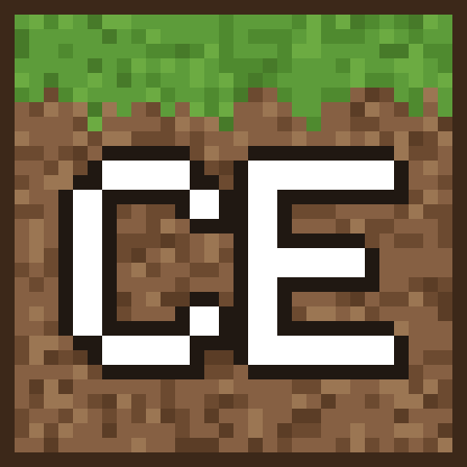

<p align="center"></p>

# Chunk Express

[](https://github.com/dennissoftman/chunk-express/actions/workflows/build.yml)
[](https://github.com/dennissoftman/chunk-express/releases/latest)
[](https://modrinth.com/mod/chunk-express)


[](LICENSE)

Faster world generation for Minecraft 1.21.1 (NeoForge) **that never changes your world.**

Chunk Express finds the parts of vanilla chunk generation that can safely run on your spare CPU
cores, moves exactly those, and proves the terrain stays bit-identical to vanilla. It also watches
the vanilla chunk system and warns you when vanilla is about to silently overwrite damaged world
data.

> **Beta.** Download the jar from [Releases](https://github.com/dennissoftman/chunk-express/releases)
> (or [Modrinth](https://modrinth.com/mod/chunk-express)) and put it in your `mods` folder. Back up your
> worlds and please [report](https://github.com/dennissoftman/chunk-express/issues) anything odd.
> What was checked before this release: [docs/RELEASE_CRITERIA.md](docs/RELEASE_CRITERIA.md).

## What it does

**Optimisations** — each one moves vanilla code to another thread without changing the code itself,
checks its own safety conditions per dimension, and falls back to vanilla behaviour (saying why)
when they are not met:

| Option | What it does | Default |
|---|---|---|
| `offloadSurface` | Runs the *surface* generation stage on worker threads, the way vanilla already runs the *noise* stage | on |
| `offloadCarvers` | Runs the *carvers* stage (caves, canyons) on worker threads too | on |

**Diagnostics** — `/chunkexpress status` shows tick timing (including server-thread work between
ticks that MSPT hides), time the server waited for chunks, time per generation stage, chunk load
and save latency, region I/O backlog, and storage problems.

**Data-loss warnings** — when stored data cannot be read, vanilla treats the chunk as missing,
generates it again and overwrites the original on the next save, usually with a single log line.
Chunk Express reports every such case it can see (read errors, damaged region entries, missing chunk
status, region header entries discarded on open) with the region file to back up. See
[docs/PERSISTENCE.md](docs/PERSISTENCE.md).

**Nothing else changes:** the world format stays vanilla Anvil, nothing is written into world
folders, and the mod can be removed at any time.

## Results so far

Ice-road benchmark: a boat crossing 5,000 blocks of fresh terrain at full speed, with Create and
Farmer's Delight installed; medians of three rides each
([full table and method](docs/BENCHMARKS.md#engine-comparison-vanilla-chunkexpress-c2me-with-create--farmers-delight)):

| | Vanilla | Chunk Express | C2ME |
|---|---|---|---|
| Server waiting for chunks per ride | 26.2 s | 0.45 s | 0 s |
| Worst server hiccup | 676 ms | 245 ms | 75 ms |
| Chunks loaded ahead on screen (of 12) | 4.4 | 6.9 | 11.3 |
| Terrain identical to vanilla | — | verified bit-for-bit | not measured |

C2ME is faster; Chunk Express changes far less and verifies what it changes. They cannot be installed
together (NeoForge refuses to start with both, and with Moonrise), since all of them work on the same
part of the game.

## Requirements

Minecraft 1.21.1, NeoForge 21.1.265 or newer within 21.1, Java 21. Install on the server, or in
singleplayer. Players joining a server do not need it.

Compatibility so far: all game tests pass with Create 6.0.10 and Farmer's Delight 1.3.4. Everything
else is untested; the optimisations never move another mod's code to another thread, because they
check what actually runs. See [docs/COMPATIBILITY.md](docs/COMPATIBILITY.md).

## Commands

Operator level 2 (in singleplayer: cheats on, or open to LAN with cheats).

| Command | |
|---|---|
| `/chunkexpress status` | All metrics, optimisations and why each is on or off, storage problems, compatibility summary |
| `/chunkexpress compat` | Detected mods and why any hook is off |
| `/chunkexpress reset` | Zero the counters (keeps the loaded-chunk set and in-flight writes), e.g. before a benchmark |

## Configuration

`config/chunkexpress-common.toml`, read when a server starts:

```toml
[instrumentation]
enabled = true              # false: every measuring hook becomes a no-op
logSessionSummary = true    # status summary in the log at shutdown
slowWriteWarnMillis = 10000 # warn about very slow region writes; 0 = off

[optimizations]
offloadSurface = true       # false = exactly vanilla
offloadCarvers = true       # false = exactly vanilla
```

JVM flag `-Dchunkexpress.disableProbes=all` (or a comma-separated list of mixin names) removes
Chunk Express' hooks entirely at startup.

## Building and testing

```bash
./gradlew build
```

```bash
./gradlew runGameTestServer
```

`build` compiles with warnings as errors and runs the unit tests; `runGameTestServer` starts a real
server and runs the in-game tests (hooks applied, saves observed end to end, damaged region files
detected, optimisations applied exactly where allowed). `runClient` and `runServer` start dev
instances.

More tools, described in [docs/BENCHMARKS.md](docs/BENCHMARKS.md) and [docs/OPTIMIZATIONS.md](docs/OPTIMIZATIONS.md):

- `./gradlew runIceRoad` / `runIceRoadChunkExpress` — the ice-road benchmark; `-Pwith=a.jar,b.jar`
  adds other mods (e.g. C2ME), `-Poptimizations=on|off` pins Chunk Express' optimisations.
- `./gradlew runGameTestServerCompat` — the game tests with the mods in `compat-mods/` (git-ignored;
  see docs/COMPATIBILITY.md for the versions).
- `-Dchunkexpress.debug.stageHashes=surface,carvers,surface_out,carvers_out` + `./gradlew stageHashDiff`
  — checks that generation output is identical at stage boundaries.
- `./gradlew worldDiff` — compares two worlds' terrain chunk by chunk.

## Documentation

- [ARCHITECTURE.md](docs/ARCHITECTURE.md) — structure, threading model, decisions
- [OPTIMIZATIONS.md](docs/OPTIMIZATIONS.md) — each optimisation: evidence, safety argument, gates, verification
- [BENCHMARKS.md](docs/BENCHMARKS.md) — the ice-road benchmark, every ride, the engine comparison
- [PERSISTENCE.md](docs/PERSISTENCE.md) — what vanilla storage actually guarantees, with evidence
- [COMPATIBILITY.md](docs/COMPATIBILITY.md) — statuses, what has been tested, scenario suite
- [RELEASE_CRITERIA.md](docs/RELEASE_CRITERIA.md) — what Beta and Release require
- [REFERENCES.md](docs/REFERENCES.md) — pinned versions, reference projects, licensing

## Roadmap

Done:

- Foundation: per-server runtime, chunk lifecycle tracking, storage probes, data-loss reports,
  `/chunkexpress`, unit and game tests.
- Instrumentation: time per generation stage, server-thread chunk waits, tick intervals, the
  ice-road benchmark, stage-boundary identity checks.
- O1 `offloadSurface`, O2 `offloadCarvers`.

Next:

1. The Beta checklist ([docs/RELEASE_CRITERIA.md](docs/RELEASE_CRITERIA.md)): more seeds, dimensions
   and presets, data packs, fallback and failure tests, low core counts, a wider compatibility matrix.
2. Measure how long chunks wait in the generation lane's queue, to see whether throughput or priority
   causes the remaining stalls.
3. The `features` stage (the largest remaining serial work): needs region locking, because it writes
   into neighbouring chunks, and the strictest gating, because it runs every mod's feature code.
4. Storage: revision-tracked saves and retries instead of vanilla's "mark saved, then write",
   parallel compression, and keeping a copy of damaged chunk data before vanilla overwrites it.
5. The Create scenario suite (factories, contraptions, trains, restarts).

## Contributing

See [CONTRIBUTING.md](CONTRIBUTING.md).

## How it is made

Developed with AI assistance; every change is checked by the tests and scripts described in
[docs/](docs/) (stage hashes against vanilla, game tests, hard-kill and fallback checks).

## Licence

[GPL-3.0-only](LICENSE). Why, and what it means for forks, modpacks and other mods:
[docs/REFERENCES.md](docs/REFERENCES.md#licensing).
